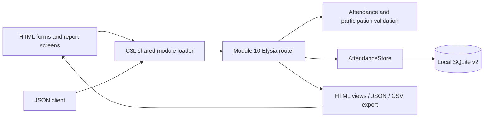
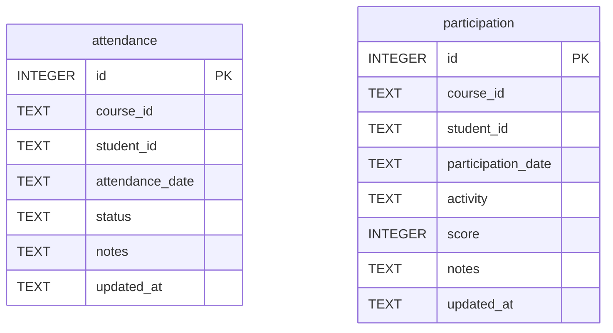

# Sprint 3 - architecture and SQLite design

The shared loader mounts index.js at /10-attendance. The router receives an injected store, so mounted HTTP tests can use a separate in-memory database. Validation protects both routes and direct store calls. Views escape user content; reportExport.js quotes CSV cells and prefixes spreadsheet formula-like text with an apostrophe.

## Physical schema

schema.sql is the canonical DDL. Both tables use an integer primary key and UTC updated_at text. Dates are real YYYY-MM-DD values validated in JavaScript. Course and student IDs remain text, not cross-module foreign keys: there is no agreed roster integration contract yet (#5).

| Table | Unique logical key | Checks and indexes |
| --- | --- | --- |
| attendance | course_id, student_id, attendance_date | status in present/excused/unexcused; course/date index |
| participation | course_id, student_id, participation_date, activity | integer score 0-5; course/date index |

There is no foreign-key relationship between the two tables. A student may have participation without an attendance mark. Report grouping joins the two record sets by course/student; it does not invent absence rows.

## Upgrade and persistence

The database opens lazily. A file database creates its parent folder; tests normally use :memory:. Before opening a real existing file, stop the app and back up attendance.sqlite (including SQLite sidecars if present). Schema version is PRAGMA user_version. Version 0/older attendance files get CREATE TABLE/INDEX IF NOT EXISTS plus version 2 inside one transaction. Existing attendance rows remain intact; DB-16 verifies this with an actual old-file fixture and a close/reopen. A newer version (>2) is refused, not downgraded (DB-17). There is no destructive automatic rollback; restore a compatible backup if needed.

The small prototype reads ordered rows and applies filters using simple JavaScript loops. SQL indexes do not make these full reads scalable. Pagination, SQL-side aggregation/filtering, audit history and multi-instance storage remain outside this candidate.

## Business rules

Attendance is one mark per day/course/student. Participation is one score per activity/day/course/student. Corrections replace values and retain IDs; no immutable audit history is created. Integer activity scores are 0-5. Present rate uses recorded marks, including excused and unexcused; it is not an enrollment-based attendance percentage. Participation average is total points divided by recorded activities.
